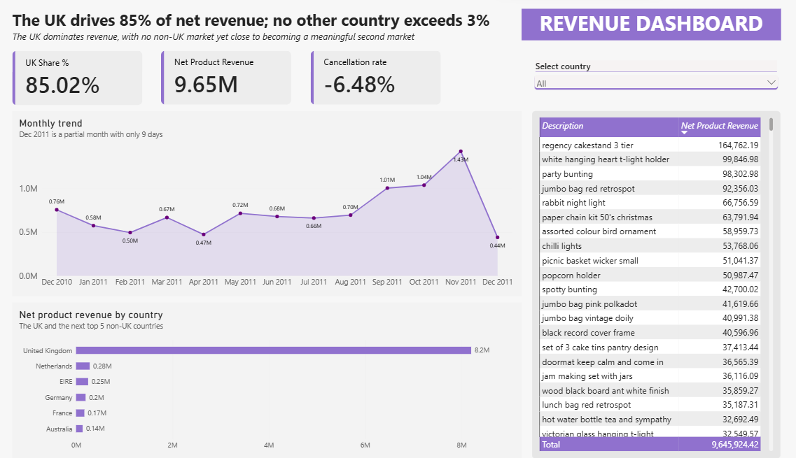

# Project 2: UK Share of Net Revenue and Top Export Markets

**Data:** Online Retail II, Kaggle (https://www.kaggle.com/datasets/jillwang87/online-retail-ii), licence CC BY 4.0. Raw data not included in this repo.

## Business question

What share of net revenue comes from the UK? Because the UK is the largest market, which 5 other countries rank highest by revenue, so that the business can know which countries to prioritize for expansion?

## Approach

- Classified every row into a `RowType` (cancellations from `InvoiceNo` starting with C; other types from `StockCode`, description and `UnitPrice`). All 541,910 rows are classified, and the counts match the raw file.

  | RowType | Count |
  |---|---:|
  | Product | 527,761 |
  | Cancellation | 9,288 |
  | Postage | 1,982 |
  | StockAdjustment | 1,336 |
  | ZeroPrice_Other | 1,079 |
  | Manual | 328 |
  | ZeroPrice_WriteOff | 83 |
  | Voucher | 34 |
  | Fee | 19 |

- Defined gross product sales as `Quantity × UnitPrice` for Product rows. Net product revenue is gross product sales plus cancelled product value (negative), excluding postage, fees, vouchers, manual and stock adjustments.
- Built the data model with a Product dimension containing distinct `StockCode`s and descriptions, linked to the sales table. Excluded 110 zero-price stock codes with null descriptions from the Product dimension after verifying that they have no impact on revenue analysis.
- Created a continuous Date table linked to the sales table for time-based analysis.
- Checked the model: the same measure gives the same figure before and after relationships, so the model adds no duplicated or lost rows.
- Date range: 1 Dec 2010 to 9 Dec 2011.

## Key findings

1. **85.02% of net revenue (8,201,285.94) comes from the UK.**
2. **The five other highest-revenue countries are the Netherlands, Ireland (EIRE), Germany, France and Australia:**

   | Country | Net product revenue | Share of net revenue |
   |---|---:|---:|
   | Netherlands | 283,373.94 | 2.94% |
   | Ireland (EIRE) | 251,486.67 | 2.61% |
   | Germany | 198,580.96 | 2.06% |
   | France | 172,660.53 | 1.79% |
   | Australia | 136,990.00 | 1.42% |

3. The top non-UK country is under 3%, so no single one is close to a second market.
4. The top five non-UK countries together have a net revenue share of about 11%, and the remaining countries about 4%.

## Recommendations

1. **UK (85% of net revenue):** Before making changes, find out how much the business depends on its biggest UK customers and whether UK sales are holding steady or declining. If the top 10 UK customers account for more than 30% of UK net revenue, prioritise keeping those relationships strong through regular contact and reliable service. If they account for less than 30%, continue monitoring before taking action.
2. **Netherlands, Ireland (EIRE), Germany, France and Australia (11% combined revenue share):** Look at which two of these countries have the strongest monthly sales growth, excluding the partial December 2011, and test a targeted offer there, such as a shipping discount or bulk-order deal. Before running the test, check whether sales come from many orders or just a few large ones. If revenue depends on only a handful of orders, the opportunity may be less reliable.

## Limitations

- Nine fee/postage `StockCode`s are hardcoded in the measures; a new code would need manual updates.
